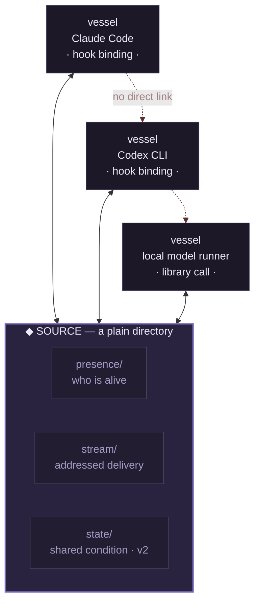

# 経絡 Keiraku

**Attach any AI agent harness to a shared memory source.**

Keiraku is a small, host-agnostic link that lets multiple AI agent sessions — running in different
CLIs, on different machines, driven by different models — see each other and share a common source
of state.

Write the attachment once. Attach it everywhere.

> **Status: alpha.** The core works and is tested — presence, addressed delivery, atomic claiming,
> and a universal hook entrypoint. What is *not* yet proven is the host bindings against live hosts:
> the wiring is documented and the entrypoint is tested, but each binding's "does this host actually
> fire this event on your platform" question is yours to verify. Each binding README says what was
> verified and what was not.

---

## The problem

You have three terminals open. One is running a coding agent on your backend, one on your frontend,
one is a local model chewing through a batch job.

None of them know the others exist.

Each agent host solves memory *within* a session, and some solve it across restarts of *their own*
sessions. None of them solve it **between different agents, in different harnesses, at the same
time**. There is no shared answer to "who else is working right now, on what, and what did they
just learn?"

Keiraku is that shared answer.

## The approach

A **hub**, not a mesh. Vessels attach to a source; they do not address each other directly. Two
vessels are connected by both being attached, not by knowing about each other.



The dotted lines are what does **not** exist. Vessels never address each other directly — they are
connected by both being attached to the same source. That removes peer routing, mesh
reconciliation, and inter-node addressing from the design entirely.

The source is a plain directory. No daemon, no server, no port. That is deliberate: a file-backed
source is the only kind that two processes on opposite sides of a container, VM, or WSL boundary can
both read without anything running in between.

## Layers

| Layer | What it does | Status |
|-------|--------------|--------|
| **L0** Protocol + client | `attach` · `heartbeat` · `publish` · `read` | ✅ implemented |
| **L1** Bindings | Per-host field mappings — hooks, or a direct library call | ✅ entrypoint tested, host wiring unverified |
| **L2** Presence | Who is alive, where, doing what | ✅ implemented |
| **L3** Stream | Addressed, exactly-once delivery between vessels | ✅ implemented |
| **L4** State | Shared condition, compare-and-set, leases | ✅ implemented |

**L0 is deliberately not hooks.** Hooks are one binding among several. If hooks were the foundation,
only hook-bearing hosts could ever attach — which would exclude every local-model runner.

## Quickstart

No dependencies. Python 3.9+.

```bash
git clone https://github.com/SherlockianAsh/keiraku
cd keiraku
python -m keiraku --source ~/.keiraku init
```

Use it directly from any agent loop you control:

```python
import keiraku

v = keiraku.attach("~/.keiraku", host="python",
                   session_id="worker-1", cwd="/srv/app", alias="worker")

v.heartbeat(status="busy", note="reindexing")     # I am alive, and this is what I am doing
print(v.read_presence())                          # who else is alive
v.publish(to="*", body="index rebuilt")           # tell them
for msg in v.read_stream():                       # what did they tell me
    print(msg["from"], msg["body"])

v.set_state("build", {"status": "green"})         # what is true right now
with v.lock("migrations"):                        # one vessel at a time
    ...
v.detach()
```

Presence answers *who is here*, stream answers *what was said*, and state answers *what is true
right now*. State is last-writer-wins by default, with `cas_state()` for writers that cannot afford
a lost update. A lock is not a separate mechanism — it is compare-and-set over a state key, so it
introduces no new primitive and no second expiry clock.

Or attach a CLI agent with no code at all, via the universal hook entrypoint:

```bash
python -m keiraku.hook --host claude-code --source ~/.keiraku
```

It reads the host's event JSON on stdin, writes peer messages to stdout, and **always exits 0** — a
link must never break its host. Per-host wiring lives in [`bindings/`](bindings/); adding a new host
is documented in [BINDINGS.md](BINDINGS.md).

See who is attached:

```bash
python -m keiraku --source ~/.keiraku who
```

## Attachment classes

Every agent host falls into one of three classes:

| Class | Meaning | How it attaches |
|-------|---------|-----------------|
| **1** | Host exposes lifecycle hooks | A hook script. Zero cooperation from the host. |
| **2** | You control the agent loop | A direct library call inside your loop. |
| **3** | Closed surface | ❌ Not possible. No attachment point exists. |

### Known hosts

| Host | Class | Surface |
|------|-------|---------|
| Claude Code | 1 | `SessionStart`, `UserPromptSubmit`, `PreToolUse`/`PostToolUse`, … |
| Codex CLI | 1 | `~/.codex/hooks.json` |
| Grok Build | 1 | `~/.grok/hooks/*.json` |
| Hermes Agent | 1 | `~/.hermes/config.yaml` shell hooks, or Python plugins |
| Ollama / custom loops | 2 | direct library call |
| Hosted chat UIs | 3 | unreachable |

Class 3 is stated plainly rather than papered over. Some things genuinely cannot be attached to, and
a tool that pretends otherwise wastes your afternoon.

### Why this is tractable

Independent vendors have converged on the same hook contract: named lifecycle events, a shell
command, JSON on stdin, JSON on stdout. One vendor's CLI even reads a competitor's hook config file
directly. The binding layer is therefore closer to **event-name mapping** than to real translation —
which is what makes "attach anywhere" a realistic goal rather than a marketing line.

## What Keiraku is not

- **Not a replacement for a host's own memory.** If your agent already persists its own state, keep
  it. Keiraku is about state *between* agents.
- **Not a chat system.** Messaging falls out of shared state; it is not the point.
- **Not a framework.** It does not want to own your agent loop. It wants four functions in it.

## Design commitments

- **Files, not a service.** Inspectable with `ls` and `cat`. Debuggable at 3am.
- **No daemon.** Nothing to start, supervise, or forget to restart.
- **Atomic claims.** Message claiming uses exclusive file creation (`O_EXCL` / `CreateNew`) — the
  only primitive that survives real contention. Rename is *not* atomic under concurrent writers, a
  lesson learned the expensive way.
- **Derived addressing.** Vessels are identified from their host-provided session identity, never a
  hand-set variable. A shared default address means delivery by race instead of by address.
- **Provenance is preserved.** A message arriving from a peer vessel is marked as *information from
  a peer*, never as an instruction from the user. This distinction is load-bearing for any agent
  that acts on what it reads.

## Roadmap

- [x] **L0** — protocol, client library, contention and staleness tests
- [x] **L2** — presence and derived addressing
- [x] **L3** — addressed, exactly-once delivery
- [x] **L1** — universal hook entrypoint, host field mappings, always-on loop example
- [ ] Verification of each binding against a live host on each platform
- [x] **L4** — shared state, compare-and-set, and leases
- [ ] Optionally expose a source as an MCP server, so MCP-speaking agents attach with no binding

## Tests

```bash
python -m pytest
```

The two tests worth reading are in `tests/test_stream.py`. Both encode failures that actually
happened rather than hypothetical ones:

- **`test_claim_is_atomic_under_true_contention`** — 16 threads released by a `threading.Barrier`
  race for one message; exactly one may win. An earlier prototype claimed by *renaming* and passed a
  concurrency test with one winner. That test was lying: each worker computed its own start delay,
  so the workers never collided. Under real simultaneity the same code produced four winners.
- **`test_concurrent_readers_split_messages_without_duplication`** — eight readers drain forty
  messages; each must be delivered exactly once. Writing this test is what exposed that `os.replace`
  is atomic on POSIX but **not contention-safe on Windows** (see [SPEC §4.5](SPEC.md)).

Both fail rather than hang if a worker dies. A hanging test tells you nothing.

## Name

経絡 *keiraku* — the meridian channels: the paths within a single body that carry what animates it,
invisible from the outside. The vessels are not separate things being wired together; they are one
system that needed a way to feel itself.

## Licence

MIT — see [LICENSE](LICENSE).

## Contributing

The most useful contribution is a **binding for a host that isn't listed above** — and it is
smaller than it sounds. A binding is a field mapping, not a program: one entry in the `HOSTS` dict,
a short README, and a test case. See [BINDINGS.md](BINDINGS.md).

Two things are asked of any contribution:

- **Say what you verified and what you didn't.** "I tested this on Linux, not on Windows" is a
  useful sentence. Silence about it is not.
- **Concurrency changes need a barrier-synchronised test.** A concurrency test that passes has not
  proved absence — it may only have failed to collide.
